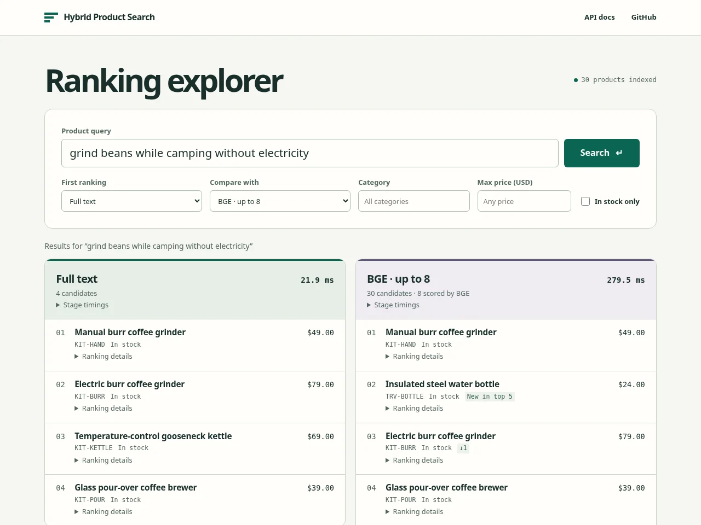

# Hybrid Product Search

A product search engine that combines PostgreSQL full-text search, E5 embeddings in pgvector and a BGE cross-encoder. A browser explorer lets you run two methods on the same query, follow products as they change position, and inspect ranking scores and CPU time.

This public portfolio implementation was built in November 2026 from the project idea described in my CV. Its evidence comes from this code, a runnable demo and the evaluations below. The original source is unavailable.

## Run the demo

```sh
docker compose up --build --detach --wait --wait-timeout 600
```

Open the [ranking explorer](http://127.0.0.1:8080/). The first run downloads the pinned model files and indexes 30 synthetic products. Try `DESK-ARM` for an exact product ID or `grind beans while camping without electricity` for a natural-language query. Expand **Ranking details** on a product or **Stage timings** above a result list. [API reference](http://127.0.0.1:8080/docs) · [Cache, shutdown and verification](docs/operations.md)



## Measured results

On a fixed pool of 875 products and 24 queries with Wayfair WANDS judgments, full-text search returned results for all 24 queries, up from 16. The hybrid result reached nDCG@5 of **0.8041** with a measured p95 of **22 ms**. The best nDCG@5 on this pool came from BGE scoring up to 30 candidates. The default BGE budget scores up to eight for a five-result request.

| Method | Paired baseline nDCG@5 | Current nDCG@5 | Current CPU p95 |
| --- | ---: | ---: | ---: |
| Full text | 0.3355 | 0.7331 | 16 ms |
| E5 dense | 0.7768 | 0.7768 | 14 ms |
| Hybrid | 0.7794 | 0.8041 | 22 ms |
| BGE, default budget (30 originally, 8 now) | 0.8079 | 0.7925 | 1.84 s |
| BGE, fixed budget of 30 | 0.8079 | 0.8266 | 5.35 s |

The external pool uses upstream human judgments. Latency covers one warmed sequential pass per method on two inference threads. The accompanying synthetic catalog has a separate 18-query evaluation with three passes. Both reports retain every ranking, including zero-result queries. [Results and raw data](docs/quality.md) · [How the WANDS pool was selected](docs/wands.md) · [CI runs](https://github.com/TrebaDripat/hybrid-product-search/actions/workflows/ci.yml)

## Search API

```sh
curl -s http://127.0.0.1:8080/search -H 'Content-Type: application/json' -d \
  '{"query":"coffee grinder","mode":"rerank","k":5,"rerank_limit":8,"filters":{"category":"kitchen","max_price_cents":5000,"in_stock":true}}'
```

`fts`, `dense`, `hybrid` and `rerank` share the same price, category and availability filters. The response includes the catalog fingerprint, stage timings, candidate count and the actual number of pairs scored by BGE. Product-level fields expose branch ranks, lexical coverage, cosine similarity, reciprocal rank fusion (RRF) score and BGE logit where applicable. The ready catalog and pinned model specifications are available at `/health` and `/models`. [Retrieval and indexing design](docs/design.md)

## Run from source

Use Python 3.12, uv and a PostgreSQL database with pgvector. Set `DATABASE_URL` to a disposable database. Indexing publishes the supplied catalog as a complete snapshot.

```sh
uv sync --frozen
uv run hybrid-search download-models
uv run hybrid-search index
uv run hybrid-search search 'noise cancelling headphones' --mode hybrid
uv run hybrid-search evaluate --passes 3 --output reports/local-evaluation.json
```

Quantized ONNX models run locally on CPU. Exact export files, tokenization settings and revisions are pinned in the repository. [Model specifications](src/hybrid_search/models.json) · [E5 model card](https://huggingface.co/intfloat/e5-small-v2) · [BGE model card](https://huggingface.co/BAAI/bge-reranker-base)
